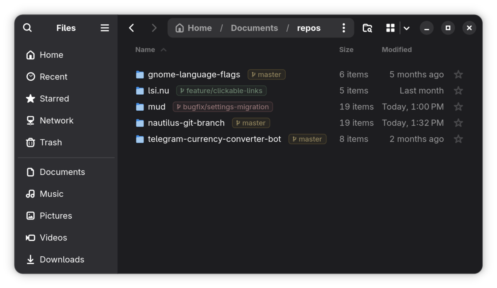

# Nautilus Git Branch



Quiet Git badges beside repository folder names in GNOME Files. Badges appear
**only in list view at the smallest icon size**, with a faint background, thin
outline and subdued colors that follow the desktop theme.

Choose list view with **Ctrl+2**, then press **Ctrl+minus** until the icons reach
minimum size. Repositories display `loading...` while their Git state is read.
Ordinary folders, remote locations, grid view and larger list rows stay blank.

| Git state | Accent | Icon |
| --- | --- | --- |
| `main`, `master` | Dim yellow | `` |
| `feat/…`, `feature/…` | Dim green | `` |
| `release/…` | Dim blue | `` |
| `bugfix/…`, `hotfix/…`, `fix/…` | Dim red | `` |
| Exact tag at detached HEAD | Pale | `` |
| Untagged detached HEAD | Dim purple/magenta | `` |
| Other branches | Neutral | `` |

Install a Nerd Font containing these glyphs for the icons to render correctly.
An attached branch takes precedence over tags. Lightweight and annotated tags
are supported; if several match HEAD, the alphabetically first tag is shown.
An untagged detached HEAD displays ` detached <short SHA>`.

## Install on Arch Linux

The upstream repository is **nautilus-git-branch**. Its Arch package is named
**nautilus-git-branch-bin** because it bundles prebuilt native dependencies.
It includes private pygit2, cffi and pycparser wheels, including libgit2.
**No `python-pygit2` package or libgit2 compilation is required.**

With `base-devel` and Git available:

```sh
git clone https://github.com/jasursadikov/nautilus-git-branch.git
cd nautilus-git-branch
makepkg -si
nautilus -q
```

Reopen Files after installation. The first release must be published with its
`v1.0.0` tag before the versioned upstream source URLs are available. For a local
checkout before publication, or when testing unpublished changes:

```sh
python3 tools/update-packaging.py --local-sources
makepkg -si
```

The package supports **x86_64 and aarch64 with CPython 3.14**. `makepkg -si`
resolves the remaining Arch dependencies, downloads the architecture-specific
wheels as checksummed sources and installs them without network access in the
build/package phases. The package must be updated when Arch changes Python's
minor version; the Python dependency bounds prevent loading an incompatible ABI.

If you previously used `make install`, remove that user installation first:

```sh
make uninstall
```

Nautilus prefers user extensions over system extensions, so an old user copy
would otherwise shadow the packaged version. The package installs the plugin
under `/usr/share/nautilus-python/extensions/`, its native dependencies under
`/usr/lib/nautilus-git-branch/python3.14/`, and documentation and licenses under
`/usr/share/`. It does not restart Nautilus or modify your user files.

To remove the Arch package:

```sh
sudo pacman -Rns nautilus-git-branch-bin
nautilus -q
```

The AUR package is prepared for publication; its presence in this repository does
not mean it has already been submitted.

## Install without an Arch package

Requires native Nautilus, nautilus-python with extension API 4.1, Python 3.11+,
PyGObject and pip for the Python interpreter used by Nautilus. Flatpak Nautilus
is not supported by these installers.

```sh
make install
nautilus -q
```

This downloads binary wheels only and installs them privately beside the user
extension in `~/.local/share/nautilus-python/extensions/`. It does not install
packages into system Python, require sudo or compile native code. Override
`PYTHON` or `DATA_HOME` when needed. Reinstall after a Python minor-version upgrade.

To prepare wheels for the same Python version and platform for offline use:

```sh
make wheels
make install WHEELHOUSE=./wheels
```

Copy the project and `wheels/` directory together to an offline machine. Remove
the user installation with `make uninstall`, then restart Files.

## Behavior and compatibility

Only repository roots receive badges. Unborn branches, linked worktrees and
checked-out submodules are supported; ordinary repository subdirectories and
bare repositories are excluded. Long names are ellipsized and treated as plain
text, not markup.

Git metadata reads run through pygit2 on two workers. There are no Git
subprocesses, recurring widget scans or repository polling. Row lifecycle
signals discover and bind badges; filesystem notifications update visible
repositories after branch or tag changes. Notifications are coalesced over
80 ms. Hidden rows release their watches, and stale results cannot overwrite
recycled rows. Ordinary folders have no individual file monitors. On filesystems
without working notifications, reopening the folder refreshes the state.

**The inline badge adapter uses private Nautilus GTK widgets.** It targets the
Nautilus 51.1 layout and keeps per-folder zoom and multiple windows independent.
The public nautilus-python API cannot insert a styled badge into the filename
row. Nautilus upgrades may require adapter changes, and compatibility with all
Nautilus 4.x versions is not guaranteed. The adapter uses native GObject weak
references so tracking survives Python wrapper collection.

## Development

Git is needed for the repository tests. Create an environment that can access
the system PyGObject bindings:

```sh
python3 -m venv --system-site-packages .venv
.venv/bin/python -m pip install --only-binary=:all: -r requirements.txt
make check PYTHON=.venv/bin/python
```

Tests cover repository states, live branch/tag/worktree notifications, loading,
accents, stale completions, native widget lifetimes and idle read counts. GTK
widget tests skip when no display is available; use `xvfb-run -a make check`
where Xvfb is available. Live visual verification in Nautilus is still necessary
when changing the private widget adapter.

## License

The extension is licensed under [MIT](LICENSE). Bundled dependencies retain
their upstream licenses and metadata; these are included in the Arch package.
